# 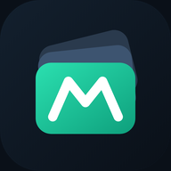 Multifolio

**Tutto il tuo patrimonio in un posto solo**: conti in banca, contanti, crypto,
azioni ed ETF, obbligazioni, oro e pool DeFi, con il totale sempre aggiornato.
I dati restano sul tuo dispositivo; la sincronizzazione, se la vuoi, è cifrata.

[Apri la web app](https://multifolio.pages.dev) ·
[Guida d'uso](GUIDA.md) ·
[Novità (changelog)](CHANGELOG.md) ·
[Pagina sul sito](https://layaris.github.io/DMReleases/multifolio/) ·
[Tutte le app](../README.md)

  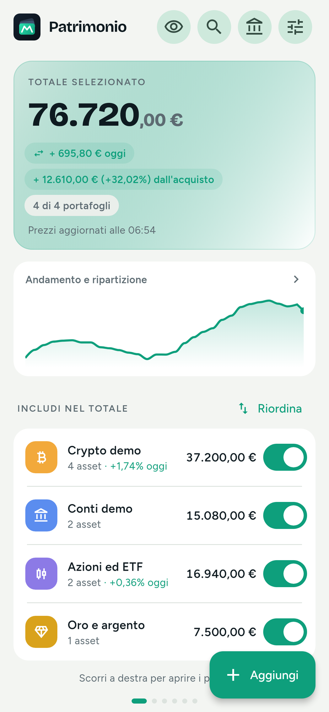
  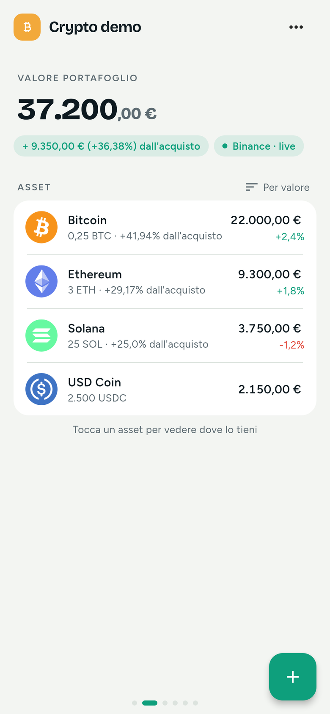
  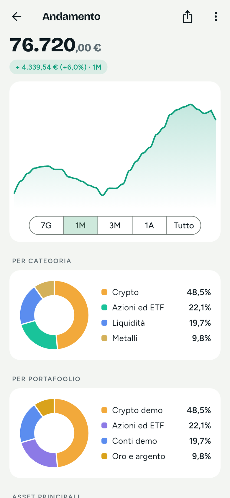

Tutte le immagini usano **dati dimostrativi inventati**.

---

## Cosa fa

**Patrimonio multi-asset**
- Portafogli pronti da un modello: Contanti, Conti bancari, Carte e app di pagamento,
  Risparmio, Crypto, Azioni ed ETF, Obbligazioni e titoli di Stato, Metalli preziosi,
  Previdenza, Crediti e debiti, Beni (auto, orologi…), oppure con nome e colore a scelta.
- Ogni asset sa **dove lo tieni** (banca, exchange, wallet, broker, cassaforte…):
  lo stesso Bitcoin può stare in più conti.
- Movimenti: deposito, prelievo, acquisto, vendita, correzione e trasferimento tra conti,
  con nota e foto della ricevuta (facoltativa).
- Prezzo medio di carico, investito e **guadagno** per asset, portafoglio e totale.
- **Profili** separati (personale, famiglia, azienda), ognuno con il suo totale.
- Importazione da **Delta** (CSV) ed esportazione CSV.

**Prezzi e valute**
- Prezzi automatici: crypto da Binance, Coinbase o CoinGecko (migliaia di token),
  azioni ed ETF da Yahoo Finance, cambi valuta BCE, oro e argento.
- **Multi-valuta**: valuta principale a scelta (euro, dollaro, dirham e molte altre)
  e una **seconda valuta** sotto il totale. Simbolo o sigla, prima o dopo il numero.
- Aggiornamento ogni pochi secondi con l'app aperta e periodico in background.

**Collegamenti automatici**
- **Indirizzi pubblici** (Bitcoin, Ethereum e reti EVM, Solana, Tron, Litecoin,
  Dogecoin, XRP): i saldi si leggono da soli.
- **Exchange** con chiavi API in **sola lettura**: Binance, Bybit, OKX, KuCoin, Gate,
  MEXC, Kraken, Bitget, Nexo Pro.
- **Posizioni DeFi** con APY e guadagno stimato (Aave, Spark, Beefy, Ether.fi,
  Kamino, Jupiter).

**Grafici e analisi**
- Andamento del patrimonio, ripartizione per categoria, portafoglio e asset.
- Rendimento per periodo (1 settimana, 1 mese, da inizio anno, 1 anno).
- Confronto con un riferimento (Bitcoin, S&P 500 o inflazione), mappa di calore,
  mini grafici nei portafogli, indice Fear & Greed.
- **Ribilanciamento**: scegli le percentuali per categoria e l'app dice quanto spostare.

**Strumenti**
- **Obiettivi** di patrimonio con stima di quando ci arrivi.
- **Movimenti ricorrenti** (stipendio, affitto, piani di accumulo).
- **Report ed esportazioni** in un posto solo: report PDF del patrimonio (mese o anno,
  anche passati), **riepilogo di fine anno** (per conto e paese, PDF o CSV), report dei
  guadagni dai pool ed esportazione CSV.
- Storico di tutti i movimenti con filtri, immagine della ripartizione da condividere
  (senza importi), widget con il totale sulla schermata Home.

**Pool DeFi** (tutto in Strumenti › Pool DeFi)
- **Guadagni dai pool**: interessi di oggi, per settimana e per mese, per pool e per
  indirizzo, con rendimento annuo stimato; anche per i portafogli tenuti fuori dal
  totale, come sezione a parte dal patrimonio. Scheda nella home e riepilogo in notifica.
- **Report PDF dei guadagni**: ogni rendita con prezzo e valore in euro del giorno,
  depositi e prelievi, indirizzi completi (provenienza dei fondi e dichiarazione).
- **Avvisi APY** dei pool (Beefy, Kamino, Jupiter, Aave, Spark e altri) dal loro link.
- **Monitoraggio pool**: grafici di APY e liquidità e avvisi di rischio (TVL in calo,
  APY anomalo, contratti in pausa, possibili exploit, liquidità di nuovo disponibile).

**Notifiche e avvisi**
- **Campanella** con tutte le notifiche degli ultimi 10 giorni, da segnare come lette o
  cancellare.
- Avvisi di prezzo sopra o sotto una soglia, **una volta o ricorrenti** (ogni 2 ore finché
  non li spegni), avvisi sul patrimonio, avvisi in percentuale sulle 24 ore,
  allarme stablecoin (se USDT, USDC, DAI e simili si staccano da 1 dollaro),
  avvisi dei pool, promemoria backup, ore di silenzio.
- **Notizie di attacchi hacker** a exchange, wallet e protocolli (spenta di default).

**Backup e sincronizzazione**
- **Backup cifrato** con password (AES-256) su file, in una cartella del telefono
  o su **Google Drive**, con copia mensile automatica.
- **Account Multifolio**: stessi dati su telefono, iPhone e sito, con cifratura
  end-to-end e **codice di recupero**.

**Aspetto e comodità**
- Temi: Classico (chiaro o scuro), Carta, Ardesia, Blu notte, Sakura Pop, Ghiaccio.
- Effetti speciali facoltativi (cifre a contachilometri, fuochi d'artificio, coriandoli,
  pioggia di monete, petali…) e musica di sottofondo.
- Dimensione del testo regolabile, blocco con impronta o volto, importi nascosti.
- Layout dedicati per **tablet** (anche in orizzontale) e **computer**.
- Ogni funzione non essenziale si accende o si spegne in **Impostazioni › Funzioni**,
  con le funzioni simili raggruppate.

---

## Usala subito nel browser

Apri **[multifolio.pages.dev](https://multifolio.pages.dev)**: è la stessa app, senza
installare nulla. I dati restano nel browser del dispositivo che usi.

Puoi anche **installarla come app** sulla schermata Home:

- **iPhone / iPad (Safari):** apri il sito › tocca **Condividi** (il quadrato con la
  freccia) › **Aggiungi alla schermata Home** › **Aggiungi**. Da iOS 16.4 in poi, così
  installata, può anche ricevere le notifiche.
- **Android (Chrome):** apri il sito › menu **⋮** › **Installa app** (o *Aggiungi a
  schermata Home*) › **Installa**.
- **Computer (Chrome o Edge):** icona **Installa** nella barra dell'indirizzo.

## Android (APK)

Scarica il file `.apk` dell'ultima versione qui sotto quando è disponibile e
installalo come spiegato nella [guida all'installazione](../README.md#installare-unapp-su-android-file-apk).
Gli aggiornamenti si installano sopra la versione che hai, senza perdere i dati.
Tutte le versioni pubblicate sono anche nelle
[Releases](https://github.com/Layaris/DMReleases/releases) di questo repository
(tag `multifolio-v<versione>-build<N>`).

<!-- multifolio:latest -->
- **Android: 0.8.1 (build 24)** del 13/11/2026 · [Scarica l'APK](https://github.com/Layaris/DMReleases/releases/download/multifolio-v0.8.1-build24/multifolio-0.8.1-build24.apk) · [Novità](CHANGELOG.md)
<!-- /multifolio:latest -->

## iPhone (IPA)

Il file `.ipa` sarà pubblicato qui quando disponibile. Si installa con **SideStore**,
**AltStore** o **Sideloadly** usando il tuo Apple ID; con un Apple ID gratuito l'app
va rinnovata **ogni 7 giorni** (i dati restano).
Le versioni per iPhone hanno tag `multifolio-ios-v<versione>-build<N>` nelle
[Releases](https://github.com/Layaris/DMReleases/releases).
Passi completi: [installare un IPA su iPhone](../README.md#installare-unapp-su-iphone-file-ipa).

In attesa dell'IPA puoi usare la [web app](https://multifolio.pages.dev) aggiunta alla
schermata Home: ha le stesse funzioni.

> Sull'app iPhone il backup su Google Drive non è disponibile: usa il backup su file
> (Condividi › File o un'app cloud) oppure l'account Multifolio.

## Aggiornamenti

- **Android:** l'app avvisa con una notifica quando qui c'è una versione nuova e scarica
  l'APK da questa pagina; installalo sopra quello che hai.
- **iPhone:** installa il nuovo `.ipa` con lo stesso programma e lo stesso Apple ID.
- **Web app:** si aggiorna da sola alla riapertura.

Cosa cambia in ogni versione: [CHANGELOG.md](CHANGELOG.md). L'ultima versione
pubblicata è sempre descritta in [`latest.json`](latest.json) (lo legge anche l'app).

## Privacy

- **I dati restano sul dispositivo**: portafogli, movimenti e impostazioni sono salvati
  in un database locale (nel browser, per la web app). Non c'è pubblicità né tracciamento.
- **Backup cifrati**: il file di backup è cifrato con AES-256-GCM e una chiave ricavata
  dalla tua password (PBKDF2, 600 000 iterazioni). Senza la password non si apre.
  Su Google Drive il backup va nella cartella riservata all'app.
- **Account Multifolio** (facoltativo): i dati partono **già cifrati** con la tua
  password; al server arrivano solo dati illeggibili, l'email e una chiave d'accesso
  che non permette di decifrarli. Per questo la password non si reimposta via email:
  serve il **codice di recupero**.
- **Chiavi API degli exchange**: restano solo sul dispositivo, cifrate, e **non** vanno
  né nei backup né sul server. Anche le foto dei movimenti restano sul dispositivo.
- **Cosa esce dal dispositivo**: le richieste dei prezzi ai servizi pubblici (Binance,
  Coinbase, CoinGecko, Yahoo Finance, BCE…), la lettura dei saldi degli indirizzi
  pubblici e degli exchange collegati, e i dati dei pool DeFi. Nella web app alcune
  richieste passano da un proxy del sito che le inoltra senza salvarle.
- **Notifiche della web app a sito chiuso**: al server vanno solo gli avvisi attivi
  (quale asset e quale soglia), i pool seguiti e, per le notizie sugli attacchi,
  solo i nomi di exchange, wallet, crypto e protocolli se scegli "i miei".
  **Mai saldi né quantità.**
- **Blocco** con impronta o volto e **importi nascosti**; con il blocco attivo anche il
  widget nasconde gli importi.

## Grafica

Screenshot con **dati dimostrativi inventati**. Tutte le immagini sono in
[`grafica/screenshot/`](grafica/screenshot/); logo e icone in [`grafica/`](grafica/).

**Telefono**

  
  
  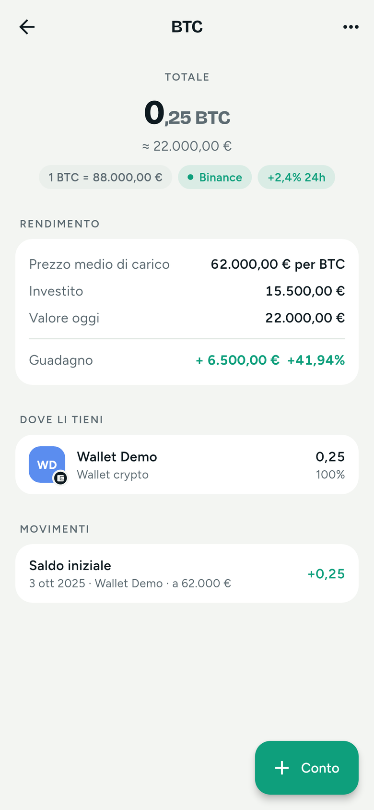
  

  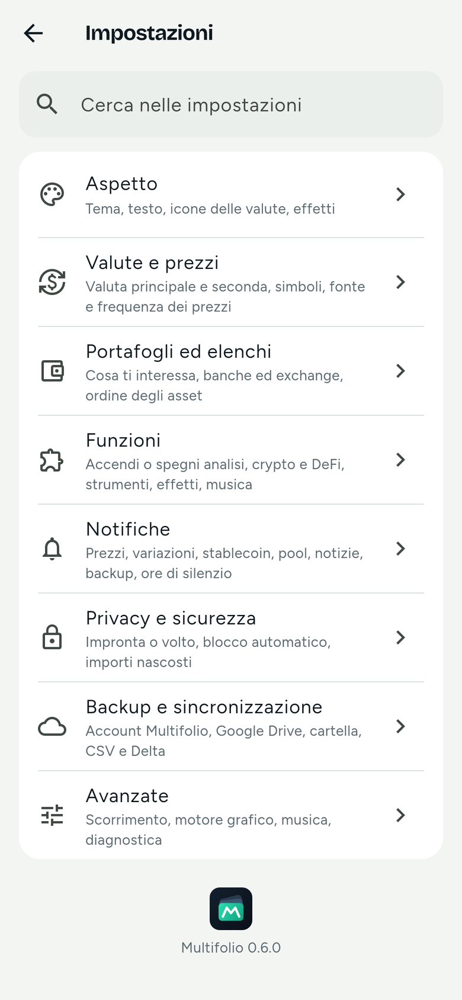
  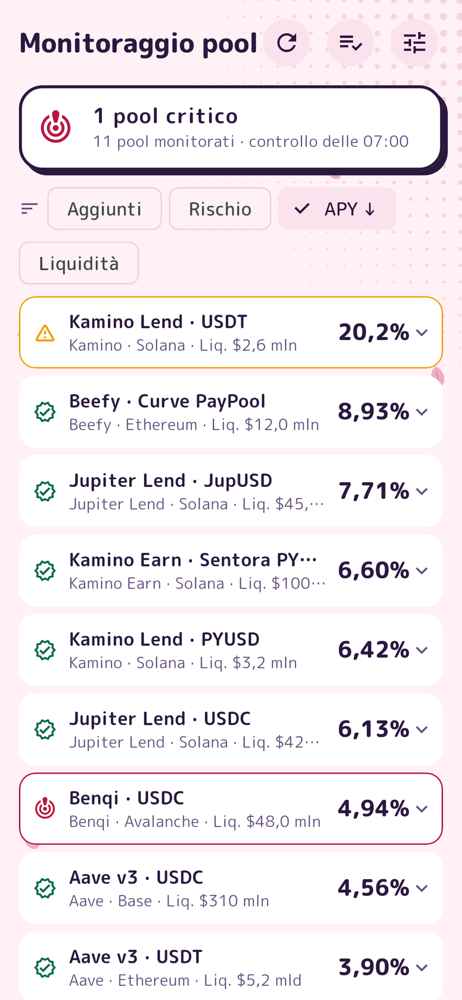
  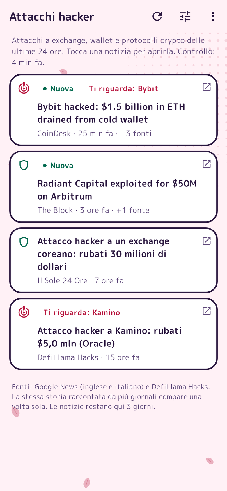
  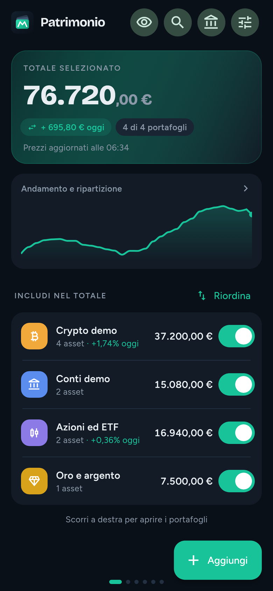

  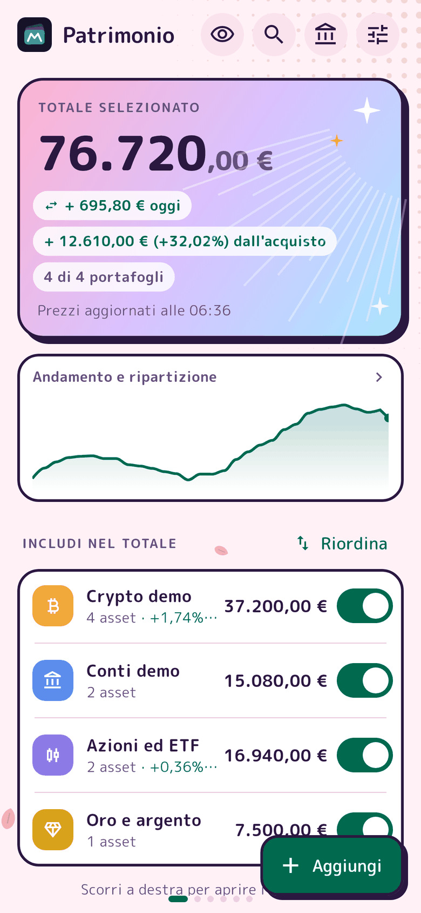
  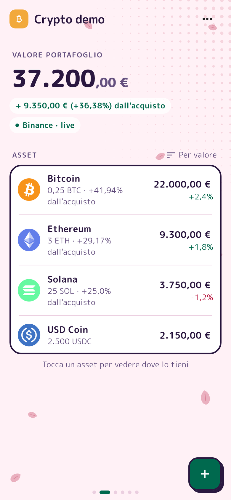
  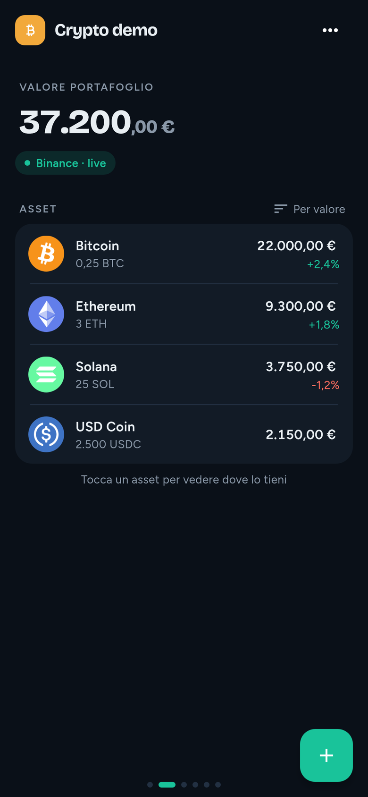
  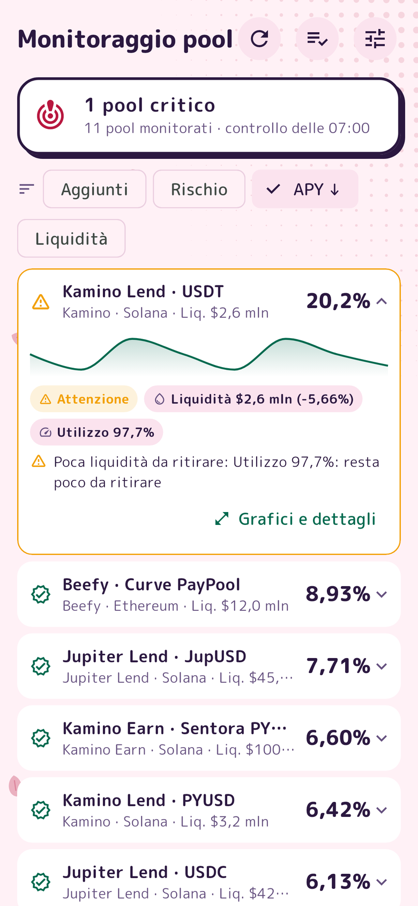

  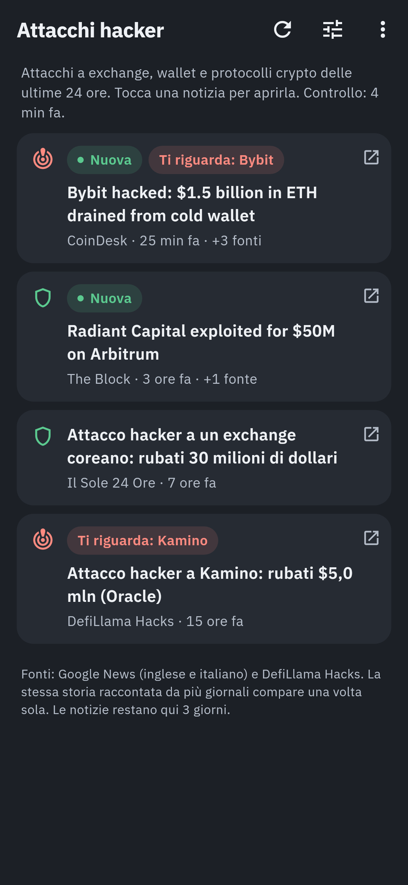

**Tablet**

  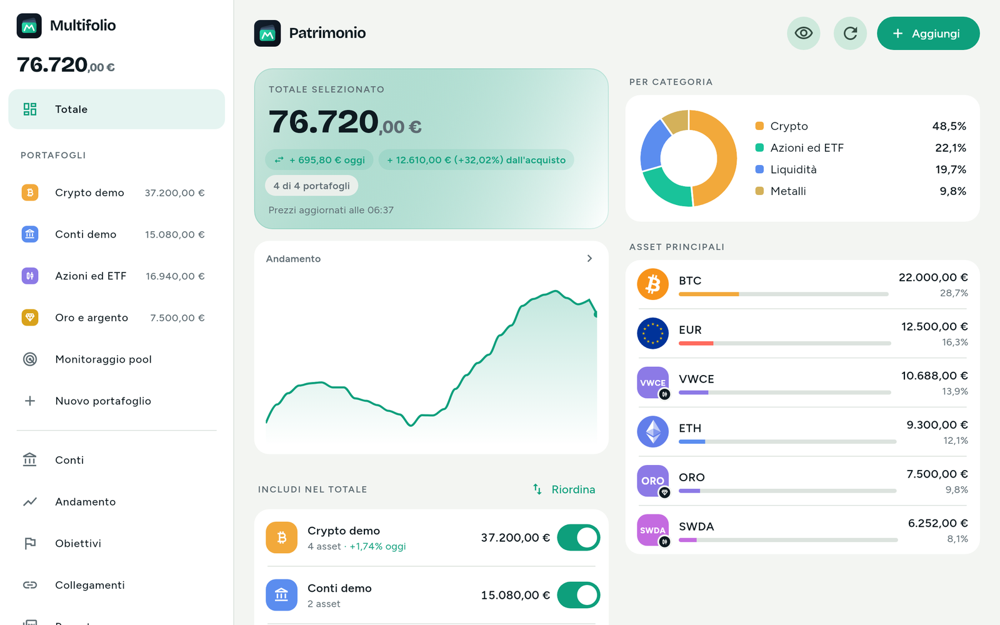
  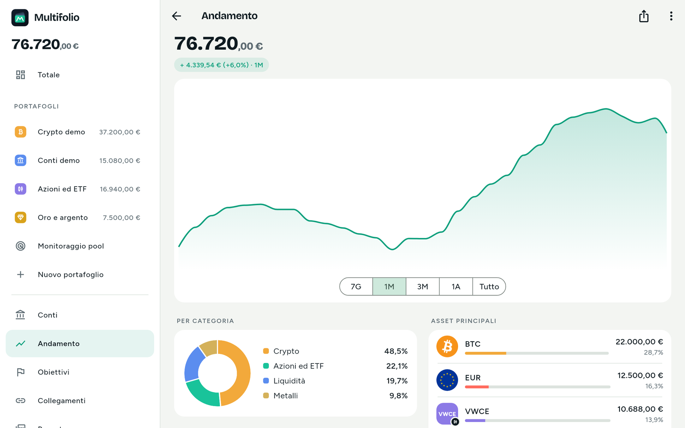

**Computer**

  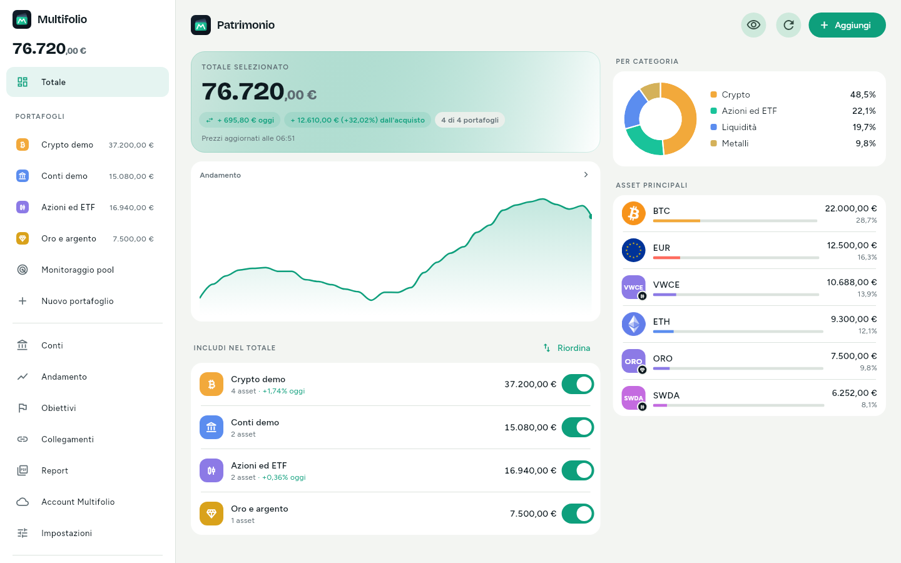
  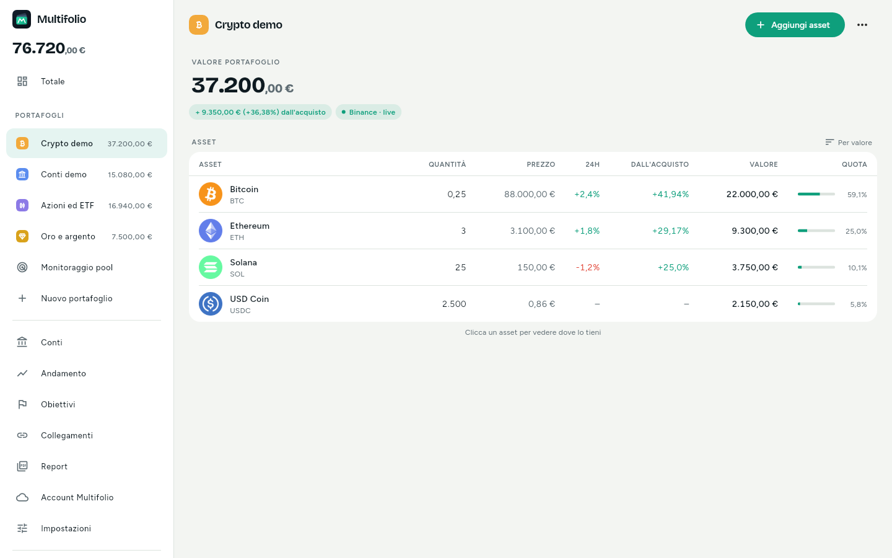

  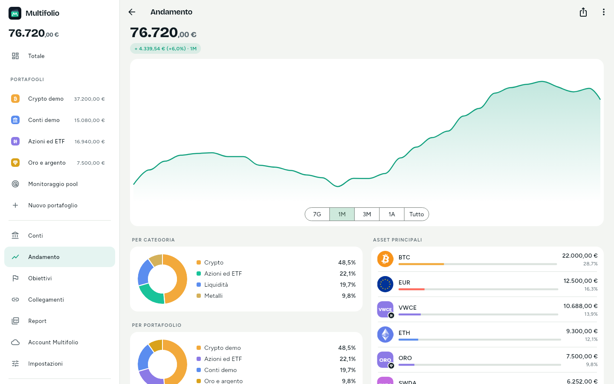
  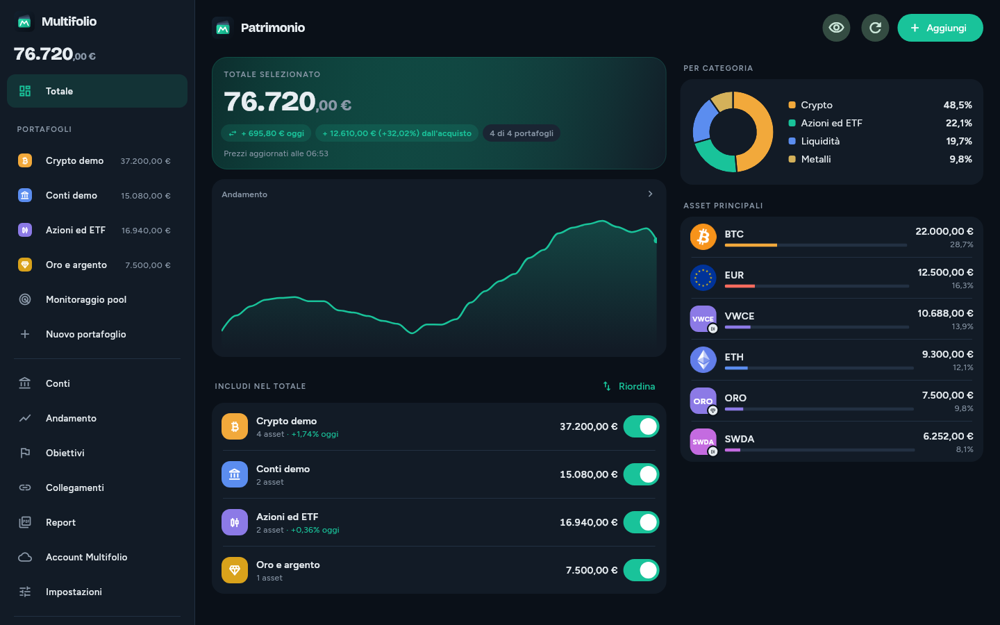

  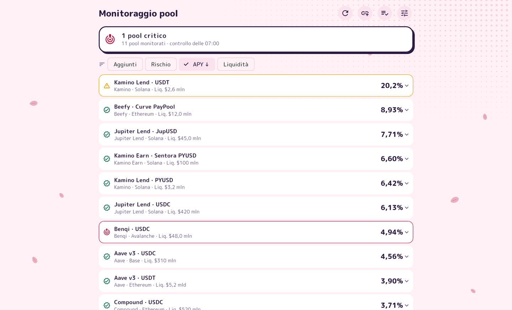

---

**Documenti:** [Guida d'uso](GUIDA.md) · [Novità](CHANGELOG.md) ·
[Segnala un problema](https://github.com/Layaris/DMReleases/issues/new/choose)

Multifolio è un'app personale, senza garanzia. Valori e analisi sono solo
informativi e non sono consulenza finanziaria. Tutti i diritti riservati.
