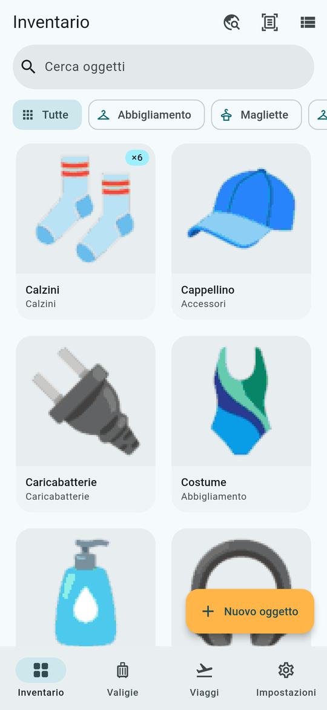
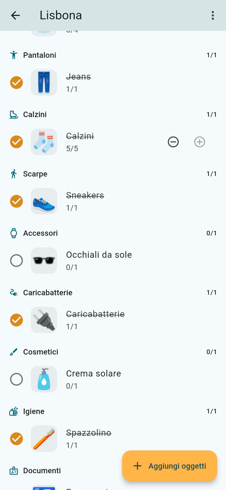
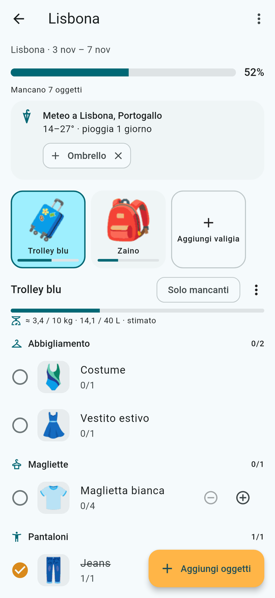

#  PackSnap

**Fotografa i tuoi oggetti, scontornali e prepara la valigia con le checklist di viaggio.**
Gratis e senza pubblicità. Senza account i tuoi dati restano sul telefono; se vuoi, la sincronizzazione
online (facoltativa e cifrata) li porta anche sugli altri tuoi dispositivi.

[Apri la web app](https://dmpacksnap.pages.dev) ·
[Guida d'uso](GUIDA.md) ·
[Novità (changelog)](CHANGELOG.md) ·
[Privacy](PRIVACY.md) ·
[Pagina sul sito](https://layaris.github.io/DMReleases/packsnap/) ·
[Tutte le app](../README.md)

  
  
  

Gli oggetti nelle immagini sono **dati di esempio**. PackSnap è il nome provvisorio dell'app.

---

## Scaricare e usare

| | Come | Stato |
|---|---|---|
| **Android** | File APK da installare | Prima pubblicazione in preparazione |
| **iPhone** | Web app da Safari | Disponibile ora |
| **Computer** | Web app dal browser | Disponibile ora: [dmpacksnap.pages.dev](https://dmpacksnap.pages.dev) |

### Android (APK)

Quando c'è, l'ultima versione è nella pagina [Releases](https://github.com/Layaris/DMReleases/releases?q=packsnap)
con il nome **PackSnap · build N** e il file `PackSnap-build-N.apk`. Serve Android 7.0 o più recente.
Come si installa: [Installare un'app su Android](../README.md#installare-unapp-su-android-file-apk).

**Aggiornamenti:** l'app controlla da sola questa pagina e, quando esce una versione nuova, mostra un
avviso (e una notifica, se le notifiche sono permesse). Tocca **Scarica**, apri il file e installalo
sopra la versione che hai: i dati restano. Gli avvisi si spengono in *Impostazioni › Versione e aggiornamenti*.

### iPhone

**Web app (consigliata):**

1. Apri **Safari** e vai su [dmpacksnap.pages.dev](https://dmpacksnap.pages.dev).
2. Tocca **Condividi** › **Aggiungi alla schermata Home**.
3. Apri PackSnap **sempre dall'icona**: Safari e l'icona hanno archivi separati.

Il primo scontorno di una foto scarica circa 44 MB (meglio con il Wi-Fi). La web app si aggiorna da sola.
Rispetto all'app Android mancano widget, promemoria a orario, import da video, riconoscimento senza internet
(c'è Gemini, facoltativo) e backup automatico. Il backup è compatibile con l'app Android.

**File IPA:** per ora non c'è. Il codice per iPhone è pronto e viene compilato, ma non è ancora pubblicato
come file `.ipa`. Se arriverà, lo troverai nelle [Releases](https://github.com/Layaris/DMReleases/releases?q=packsnap)
e si installerà come spiegato in [Installare un'app su iPhone](../README.md#installare-unapp-su-iphone-file-ipa).

---

## Cosa fa

- **Inventario con le foto.** Fotografi un oggetto e l'app toglie lo sfondo da sola (scontorno).
  Puoi fotografare anche più oggetti insieme, oppure scegliere fino a 30 foto dalla galleria
  (un oggetto per foto) e controllare i nomi in una lista sola.
  Se lo scontorno non è perfetto, lo correggi con il pennello.
- **Nome suggerito.** L'app riconosce l'oggetto sul telefono, senza internet. Se vuoi, puoi usare
  Google Gemini con una tua chiave gratuita. Il suggerimento si applica solo se lo confermi.
- **Valigie** con foto, tipo e colore.
- **Viaggi** con più valigie e una checklist per categoria: spunte, quantità, percentuale di completamento,
  filtro "solo mancanti", viaggi duplicabili e archiviabili.
- **Liste modello** riutilizzabili (la valigia del weekend, quella del mare…).
- **Etichetta per il bagaglio** con QR da stampare in PDF, e **Dov'è?** per trovare in quale valigia
  hai messo un oggetto.
- **Backup** in un unico file, anche protetto da password, tra Android, iPhone e computer.
- **Tema chiaro e scuro**, italiano e inglese.

### Funzioni extra (facoltative)

Si accendono in *Impostazioni › Funzioni extra*. All'inizio sono tutte spente, così l'app resta semplice.

- **Peso e volume** della valigia, con i limiti che scegli tu
- **Meteo** della destinazione, con suggerimenti (ombrello, giacca…)
- **Promemoria** prima della partenza e lista *Prima di uscire*
- **Oggetti mai usati**: a fine viaggio segni cosa hai usato davvero
- **Documenti e scadenze**: avviso se il passaporto scade prima o durante il viaggio
- **Condivisione** della lista con chi viaggia con te
- **Widget** con il prossimo viaggio (solo Android)
- **Denuncia bagaglio smarrito**: PDF con foto e contenuto della valigia
- **Assistente viaggio** che propone cosa portare
- **Import da video**: riprendi i tuoi oggetti e l'app li aggiunge (solo Android)
- **Checklist del ritorno**: per non dimenticare niente in hotel
- **Cose da fare prima di partire**: check-in online, parcheggio, roaming…
- **Backup automatico** in una cartella del telefono (solo Android)

---

## Grafica

Nella cartella [`grafica/`](grafica/): icona (192, 512 e versione adattiva), logo a 1024 px e
[screenshot](grafica/screenshot/) del telefono, in tema chiaro e scuro.

Colori: verde petrolio `#2A6670` e ambra `#FFB547`.
