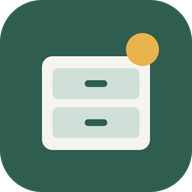
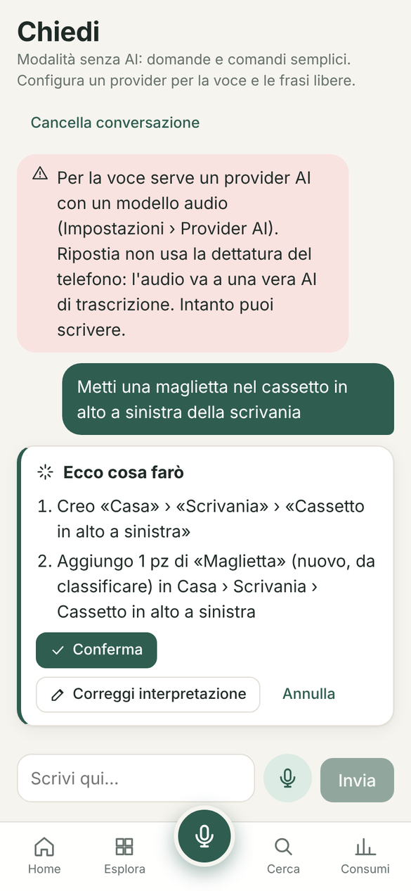
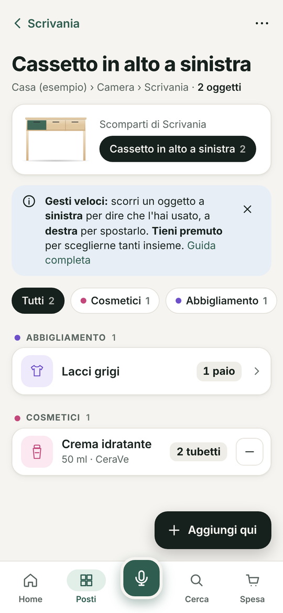
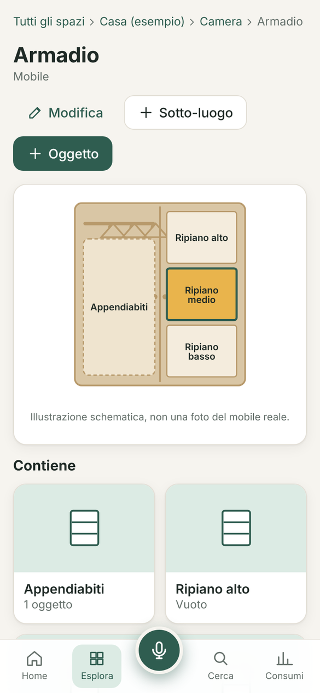

#  Ripostia

**Ogni cosa al suo posto. Basta chiedere.**
Inventario personale visuale: stanze, mobili, cassetti e oggetti, con foto, quantità e consumi.
Dici o scrivi «metti una maglietta nel cassetto in alto a sinistra della scrivania» e Ripostia la sistema.
Gratis, senza account, senza pubblicità: i dati restano sul tuo dispositivo.

[Apri la web app](https://ripostia.pages.dev) · [Novità (changelog)](CHANGELOG.md) · [Privacy](PRIVACY.md) ·
[Pagina sul sito](https://layaris.github.io/DMReleases/ripostia/) · [Tutte le app](../README.md)

  
  
  

Gli oggetti nelle immagini sono dati di esempio.

---

## Scaricare e usare

| | Come | Stato |
|---|---|---|
| **Android** | File APK da installare | Vedi sotto |
| **iPhone** | Web app da Safari (Condividi › Aggiungi alla schermata Home) | Disponibile: [ripostia.pages.dev](https://ripostia.pages.dev) |
| **Computer** | Web app dal browser | Disponibile: [ripostia.pages.dev](https://ripostia.pages.dev) |

<!-- ripostia:latest -->
- **Android: 0.4.0** del 13/11/2026 · [Scarica l'APK](https://github.com/Layaris/DMReleases/releases/download/ripostia-v0.4.0/Ripostia-0.4.0.apk) · [Novità](CHANGELOG.md)
<!-- /ripostia:latest -->

### Android (APK)

Le versioni sono nella pagina [Releases](https://github.com/Layaris/DMReleases/releases?q=ripostia) con il nome
**Ripostia X.Y.Z** e il file `Ripostia-X.Y.Z.apk` (accanto c'è il file `.sha256` con l'impronta di controllo).
Serve Android 7.0 o più recente. Come si installa: [Installare un'app su Android](../README.md#installare-unapp-su-android-file-apk).

**Aggiornamenti:** l'app controlla da sola, al massimo una volta al giorno, se c'è una versione nuova e mostra un avviso.
Scarica il nuovo APK e installalo sopra quello che hai: i dati restano.

### Importante: i dati sono solo sul tuo dispositivo

Ripostia non ha un cloud: per non perdere l'inventario (telefono rotto, app disinstallata) usa
**Impostazioni › Backup e ripristino** e salva il file di backup su Drive o sul PC. L'app te lo ricorda.

## Funzioni AI (facoltative)

Voce, frasi libere, riconoscimento foto, illustrazioni e scansione video usano un provider AI a tua scelta
(Gemini, NanoGPT o compatibile OpenAI) con la **tua** chiave, che resta sul telefono. Possono avere un costo sul tuo
account del provider. Senza AI l'app si usa a mano, e le domande e le liste semplici funzionano lo stesso.
