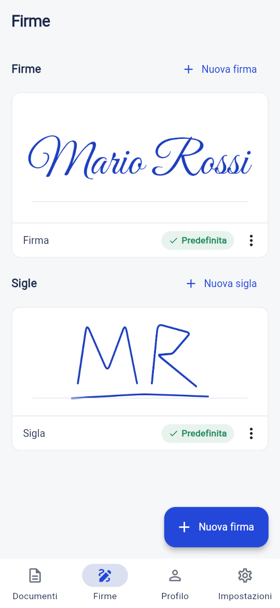
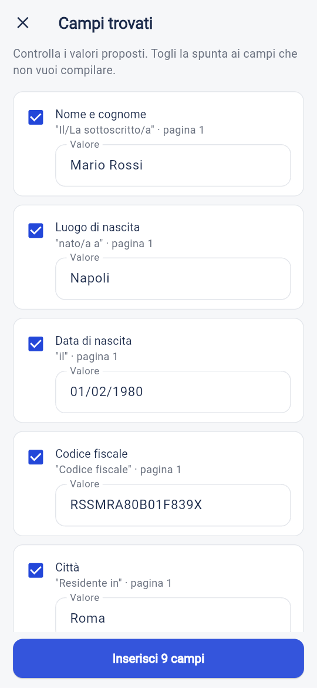
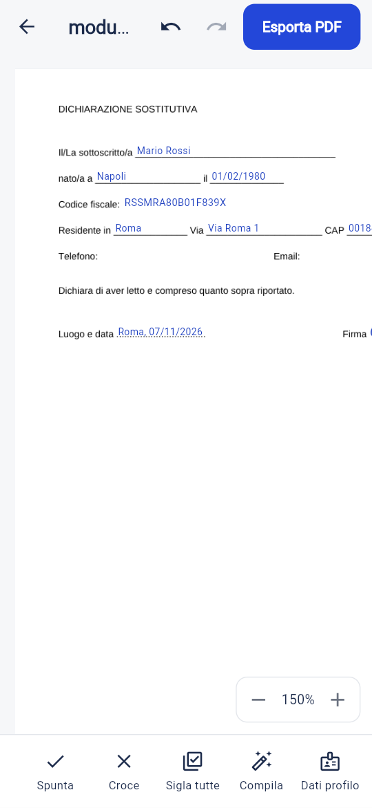

#  Sigla

**Compila e firma PDF dal telefono, dal tablet o dal computer.**
Gratis per uso personale, senza account e senza pubblicità: documenti e firme restano sul dispositivo.

[Guida d'uso](GUIDA.md) ·
[Novità (changelog)](CHANGELOG.md) ·
[Privacy](PRIVACY.md) ·
[Pagina sul sito](https://layaris.github.io/DMReleases/sigla/) ·
[Tutte le app](../README.md)

  
  
  

Nomi, codici e indirizzi nelle immagini sono **dati di esempio**. Sigla è il nome provvisorio dell'app.

---

## Scaricare e usare

| | Come | Stato |
|---|---|---|
| **Android** | File APK da installare | Prima pubblicazione in preparazione |
| **iPhone** | File IPA da installare con SideStore, AltStore o Sideloadly | Prima pubblicazione in preparazione |
| **Computer** | Web app dal browser | Non ancora online |

### Android (APK)

L'ultima versione è nella pagina [Releases](https://github.com/Layaris/DMReleases/releases?q=sigla)
con il nome **Sigla · build N** e il file `Sigla-build-N.apk`. Serve Android 7.0 o più recente.
Come si installa: [Installare un'app su Android](../README.md#installare-unapp-su-android-file-apk).

**Aggiornare:** scarica il nuovo APK e installalo sopra la versione che hai: i dati restano.
Prima di un aggiornamento importante fai un backup da *Impostazioni › Esporta backup*.

### iPhone (IPA)

Il file `Sigla-build-N.ipa` sarà nelle stesse [Releases](https://github.com/Layaris/DMReleases/releases?q=sigla).
L'IPA non è firmato: si installa con il tuo Apple ID tramite **SideStore**, **AltStore** o **Sideloadly**
e con un Apple ID gratuito va rinnovato **ogni 7 giorni** (i dati restano).
Passi completi: [Installare un'app su iPhone](../README.md#installare-unapp-su-iphone-file-ipa).

Su iPhone il blocco con Face ID funziona; "Apri con" da altre app per ora no: apri i PDF da Sigla
con **Documenti › Apri PDF**.

---

## Cosa fa

- **Firme illimitate**, ognuna con un nome, e **sigle** (le iniziali) per siglare le pagine.
  - **Disegna** con il dito, lo stilo o il mouse: tratto liscio, con la pressione di Apple Pencil e stilo,
    inchiostro blu o nero, spessore regolabile, annulla e ripeti.
  - **Importa da una foto**: firma su carta bianca, fotografa e l'app toglie lo sfondo da sola.
    Un cursore regola la soglia se serve.
  - **Scrivi** il tuo nome e diventa una firma in corsivo.
- **PDF**: apri un file, oppure **scansiona** un documento con la fotocamera (correzione della prospettiva)
  o crea un PDF **da immagini**. Su Android anche da *Apri con* e *Condividi*.
- Aggiungi **firma, sigla, testo, data di oggi, spunta ✓ e croce ✗**. Trascini, ridimensioni, elimini.
- **Sigla tutte le pagine** in un tocco, nella stessa posizione.
- **Moduli**: compila i campi dei PDF compilabili e riempili dal tuo **profilo** (nome, codice fiscale,
  indirizzo…).
- **Compila automaticamente** anche i moduli "di carta" (*Nome: ______*): l'app trova le etichette e
  propone i tuoi dati. Vedi sempre un'**anteprima** e confermi tu: niente viene inserito da solo.
  Sull'app Android funziona anche con i **documenti scansionati**: il telefono legge il testo della
  pagina da solo, senza internet. In alternativa c'è il **riconoscimento AI** facoltativo, con una tua
  chiave Anthropic.
- **Esporta PDF**: firme e testi diventano parte del documento (non modificabili), poi salvi o condividi.
- **Backup** in un unico file `.sigla` protetto da password, con *unisci* o *sostituisci* all'import.
- **Blocco firme** con impronta, Face ID o PIN (Android e iPhone).
- Tema chiaro e scuro, interfaccia in italiano.

> La firma grafica apposta con Sigla è una **firma elettronica semplice** (Regolamento eIDAS),
> non una firma digitale qualificata.

---

## Grafica

Nella cartella [`grafica/`](grafica/): icona (192, 512 e versione adattiva), logo a 1024 px e
[screenshot](grafica/screenshot/) di telefono e computer, in tema chiaro e scuro.

Colori: blu penna `#2347D9`, inchiostro `#1B2A4A`, carta `#F6F7F9`.
